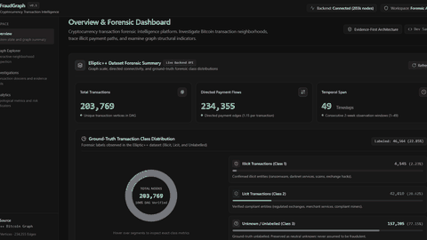
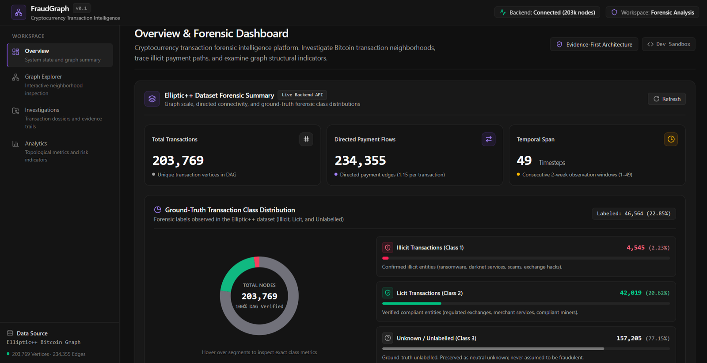
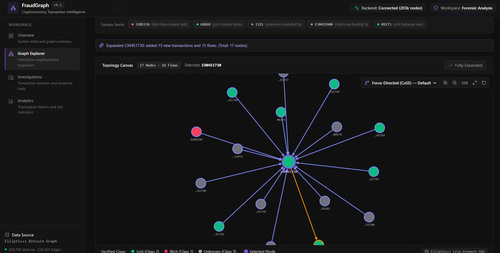
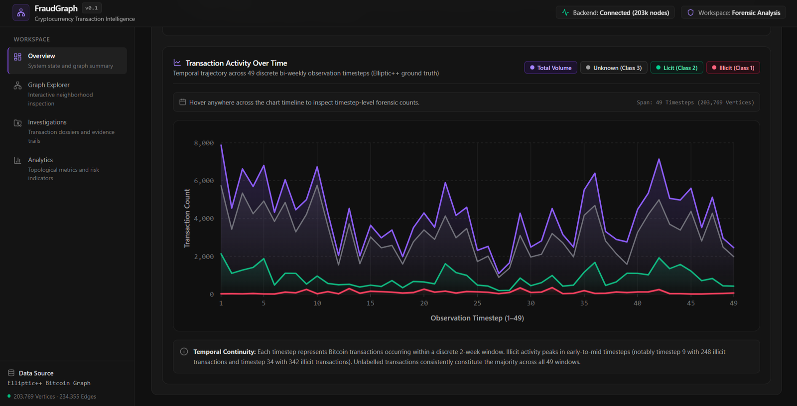
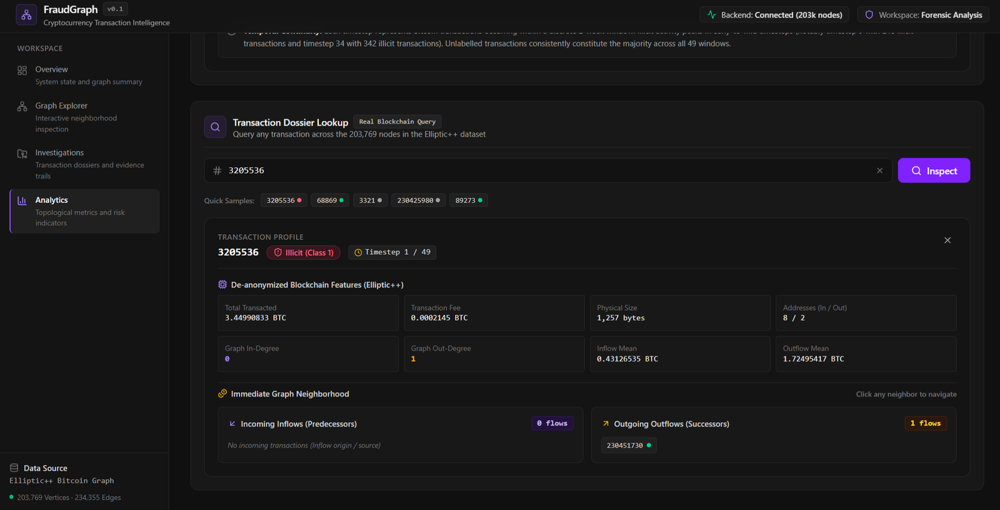
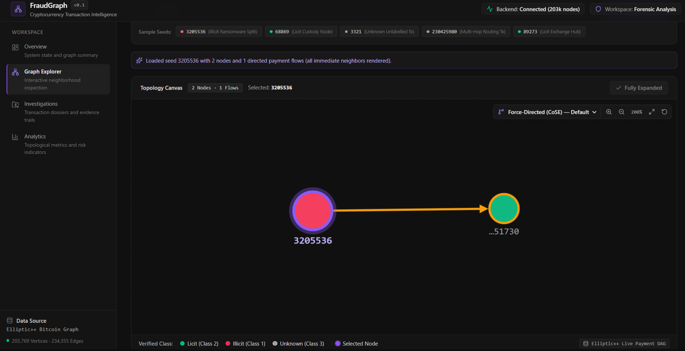

# FraudGraph

<p align="center">
  <strong>Follow the flow. Find the connections.</strong><br>
  An interactive explorer for Bitcoin transaction networks.
</p>

FraudGraph is a project I built to make a large transaction dataset easier to explore visually. Rather than digging through rows of data, you can move around a transaction network, inspect connections, and see how labelled activity changes over time.

It uses the **Elliptic++ Bitcoin Transactions Dataset**. The focus is on exploration and visual analysis—not treating a connection as proof of fraud.

## Demo

<p align="center">
  
</p>
<p align="center"><em>From dataset-level analytics to exploring connected transaction neighborhoods.</em></p>

## A look inside

<p align="center">
  
</p>
<p align="center"><em>The overview: transaction counts, graph size, and the dataset's supplied class labels.</em></p>

<table>
  <tr>
    <td width="50%" valign="top">
      
      <p><strong>Explore the network</strong><br>Expand a transaction's neighborhood and follow its recorded connections.</p>
    </td>
    <td width="50%" valign="top">
      
      <p><strong>Watch activity over time</strong><br>Compare class counts across the dataset's 49 observation windows.</p>
    </td>
  </tr>
  <tr>
    <td width="50%" valign="top">
      
      <p><strong>Inspect a transaction</strong><br>Look at a record's available features and immediate neighbors.</p>
    </td>
    <td width="50%" valign="top">
      
      <p><strong>Start with one transaction</strong><br>The graph begins with a seed and can grow as you explore more neighbors.</p>
    </td>
  </tr>
</table>

## What you can do

- **Get the lay of the land.** The Overview page gives a quick read on dataset size and the supplied transaction classes.
- **Explore connections.** Select a node and expand its neighborhood to see the transactions directly linked to it.
- **Compare activity over time.** Use the timeline charts to see how the labelled classes vary across observation windows.
- **Inspect individual records.** The API provides dataset summaries, transaction details, and neighboring transactions.

## Built with

| Part | Tools |
|---|---|
| Frontend | React, TypeScript, Vite |
| Interactive graph | Cytoscape.js, Dagre |
| Backend API | Python, FastAPI |
| Data and graph work | Pandas, NetworkX |

## The dataset, at a glance

| Transactions | Directed edges | Features | Timesteps |
|---:|---:|---:|---:|
| 203,769 | 234,355 | 183 | 49 |

The class labels are supplied by the dataset in `txs_classes.csv`:

- **1 — Illicit**
- **2 — Licit**
- **3 — Unknown**

FraudGraph reads and displays these labels; it doesn't create or independently verify them. “Unknown” means the dataset does not provide a licit or illicit label for that transaction.

### Get the data

The raw dataset isn't stored in this repository. Download the transaction files and place them in `data/raw/`:

- `txs_classes.csv` — class labels
- `txs_edgelist.csv` — transaction relationships
- `txs_features.csv` — transaction features

Dataset links:
- [Elliptic++ official repository](https://github.com/git-disl/EllipticPlusPlus)
- [Transaction dataset details](https://github.com/git-disl/EllipticPlusPlus/blob/main/Transactions%20Dataset/README.md)
- [Original research paper](https://doi.org/10.1145/3580305.3599803)

Please credit the original authors when using the dataset in academic work, and check the dataset's terms before redistributing it.

## Run it locally

You'll need Node.js/npm and Python installed.

### 1. Clone the repo

```bash
git clone https://github.com/ryuupuff/FraudGraph.git
cd FraudGraph
```

### 2. Start the frontend

From the project root:

```bash
npm install
npm run dev
```

Vite will show the local URL in your terminal.

### 3. Start the backend

In a second terminal, from the project root, create and activate a virtual environment, then install the backend dependencies.

**Windows PowerShell:**

```powershell
python -m venv .venv
.\.venv\Scripts\Activate.ps1
pip install -r backend/requirements.txt
python -m uvicorn backend.app.main:app --host 127.0.0.1 --port 8000 --reload
```

Make sure the three dataset files are in `data/raw/` before running dataset-backed features.

### API endpoints

- `GET /api/health` — check that the API is up
- `GET /api/dataset/summary` — dataset summary
- `GET /api/transactions/{tx_id}` — details for one transaction
- `GET /api/transactions/{tx_id}/neighbors` — neighboring transactions

## A note on interpretation

A graph can make relationships easier to spot, but a connection is not proof of wrongdoing. The labels reflect the source dataset, and this project is currently a visualization and exploration tool—not a validated fraud-prediction model. The transaction data is pseudonymous; this project isn't intended to identify private individuals.

## License

A code license hasn't been added yet, so please don't assume the repository is licensed for reuse. The dataset has its own terms, separate from this project.
